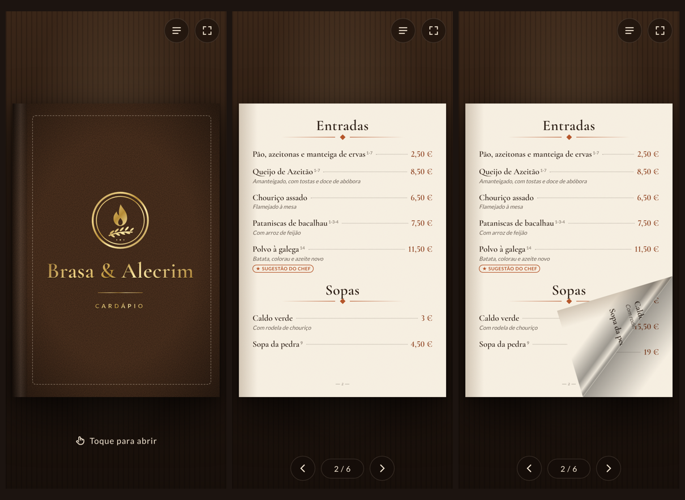
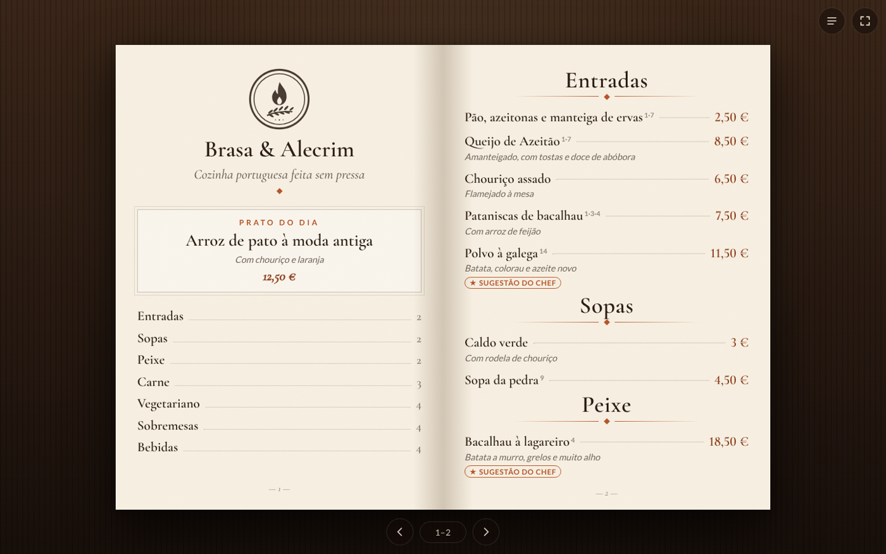
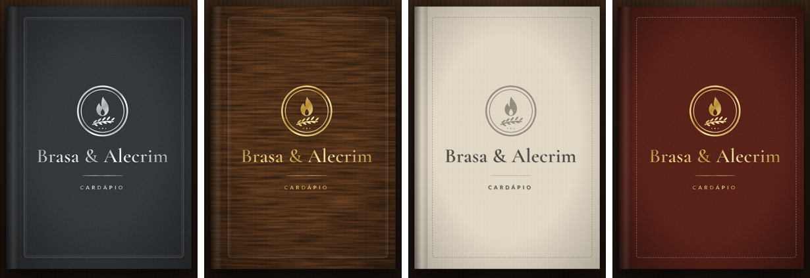
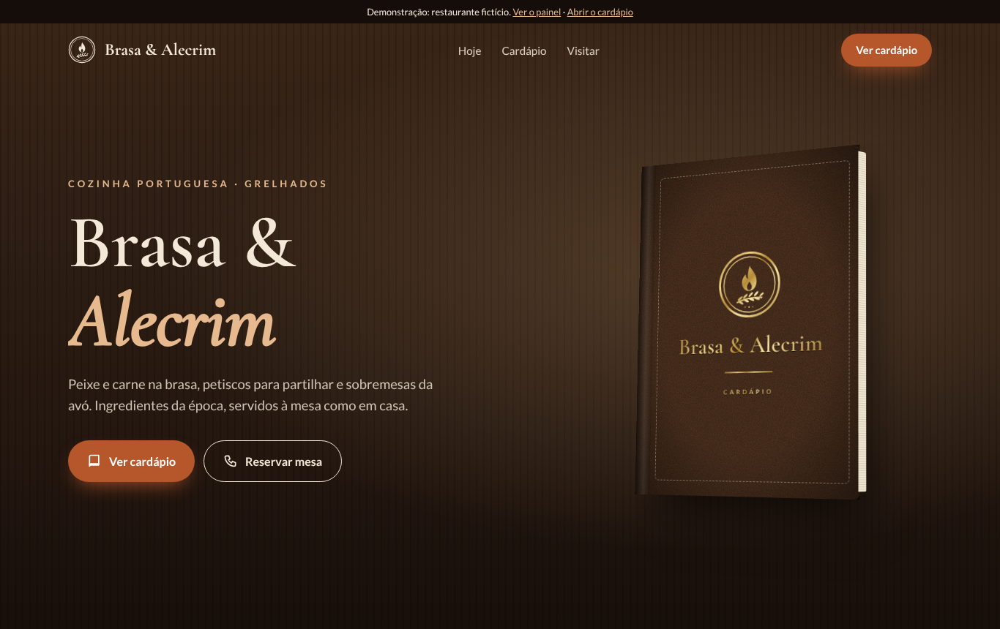
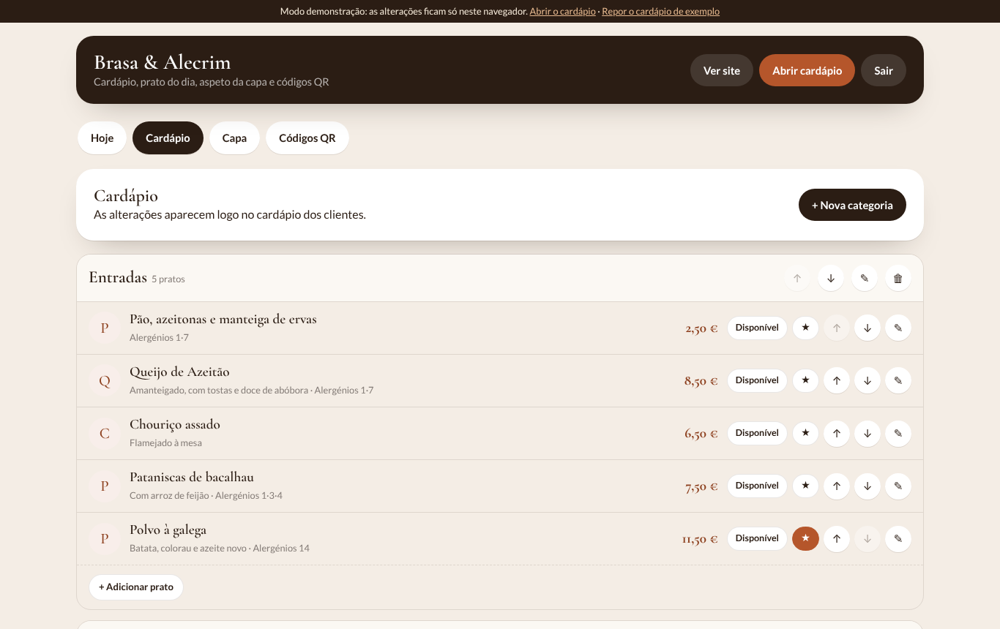

# Template Restaurant

Site + **cardápio digital em forma de livro** + painel do dono, para restaurantes e cafés. Um projeto Firebase por restaurante; muda-se só `public/restaurante.js`.

**Demonstração (restaurante fictício "Brasa & Alecrim"):** https://joaoantunesss.github.io/Template-Restaurant/ · [cardápio](https://joaoantunesss.github.io/Template-Restaurant/public/menu.html) · [painel](https://joaoantunesss.github.io/Template-Restaurant/public/admin.html)

 

 

## O que faz
- **Cardápio em livro:** capa de couro, madeira, ardósia ou linho com o nome e o logótipo gravados (dourado, prata ou relevo); as páginas viram a seguir o dedo; ecrã inteiro no telemóvel; duas páginas no computador.
- **QR das mesas:** abre sempre o cardápio atualizado (`/menu`), com o número da mesa. Nunca é preciso reimprimir.
- **Painel:** pratos, preços, fotos, alergénios (14 da UE), esgotados, prato do dia, aviso, aspeto da capa e cartões QR para imprimir. Tudo aparece logo no cardápio.
- **Site:** prato do dia, sugestões do chef, cardápio, horário, morada e reservas por telefone/WhatsApp.
- Não liga a nenhum sistema de cozinha nem de faturação.

Instalação e personalização: ver [LEIA-ME.md](LEIA-ME.md).

Bibliotecas incluídas: [StPageFlip](https://github.com/Nodlik/StPageFlip) 2.0.7 (MIT) e [qrcode-generator](https://github.com/kazuhikoarase/qrcode-generator) 1.4.4 (MIT).
